<b>Websites, business systems and AI assistants for small and mid-sized businesses</b> 
Dresden, Germany · working remote across Europe · German & English

  <a href="https://webdrift.io">webdrift.io</a> ·
  <a href="https://webdrift.io/en/contact">Contact</a> ·
  <a href="https://www.linkedin.com/company/webdrift-io/">LinkedIn</a> ·
  <a href="https://x.com/Webdriftio">X</a> ·
  <a href="https://www.instagram.com/webdrift.io/">Instagram</a> ·
  <a href="https://www.facebook.com/webdrift.io">Facebook</a>

---

### What we build

- **Websites & web apps**: fast, individually designed sites with their own CMS, from landing pages to portals.
- **Business systems**: CRM, booking, quotes and invoices, built around how your business actually works.
- **AI automation**: workflows and AI agents for internal tasks, GDPR-compliant and under your control.
- **Search & AI visibility**: technical SEO and visibility in AI search.
- **Branding**: logo, identity and brand systems.

### Drifty: our voice AI website assistant

Drifty is the chat and voice assistant on [webdrift.io](https://webdrift.io). It answers questions about the business, guides visitors around the site, and books calls, in German, English and Arabic.

### How we work

Research first (market, channels, competitors) → analysis → a **free clickable prototype before you pay** → build → test → launch.
You own everything we build. Hosting is in the EU.

### Why clients choose us

- **Prototype before payment**: you click through your new site before paying anything.
- **Fixed prices, no lock-in**: clear packages, and you own the code, content and accounts.
- **Performance built in**: fast pages, Lighthouse 90+ as a target, GDPR-friendly by default.
- **One team, end to end**: research, design, development, automation and care.

### Stack

`Next.js` · `React` · `TypeScript` · `Node.js` · `MariaDB / MySQL` · `Drizzle ORM` · `Docker` · `Nginx` · `Three.js / WebGL`

---

Need a website or an AI assistant? <a href="https://webdrift.io/en/contact"><b>Talk to us →</b></a>

